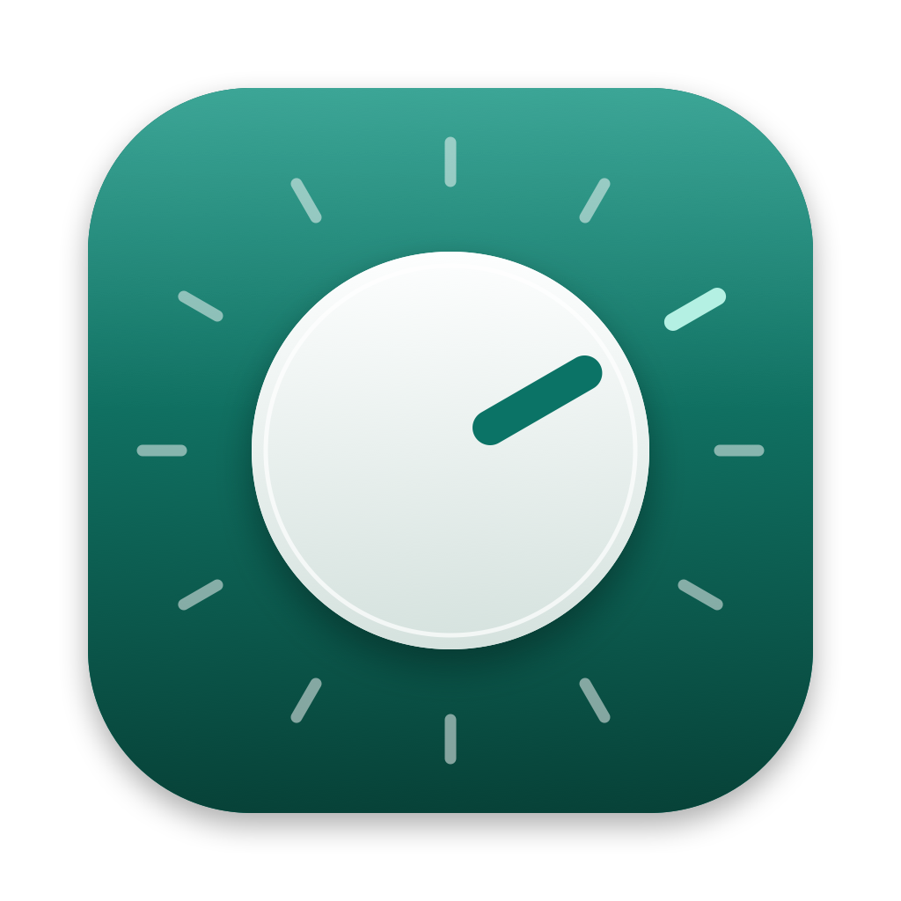
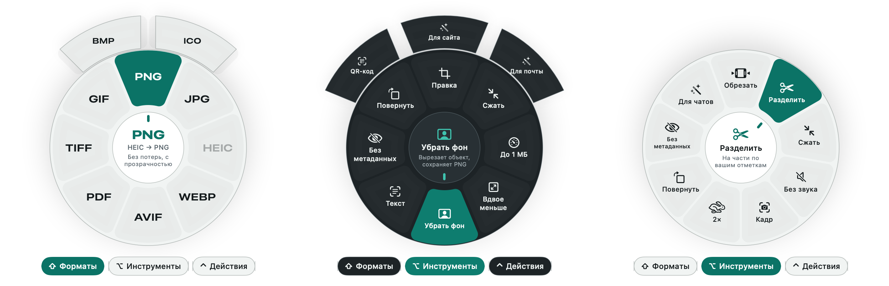
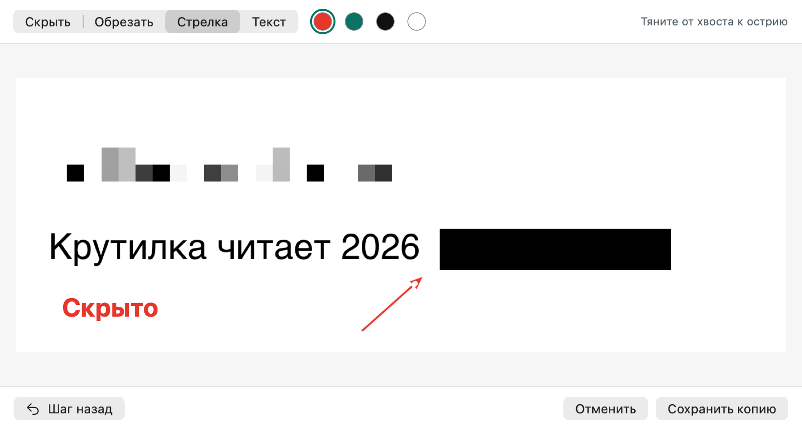

<p align="center">
  
</p>

<h1 align="center">Крутилка</h1>

<p align="center">
  Конвертер файлов для Mac, который живёт в строке меню.<br>
  Начни тянуть файл, нажми Shift и отпусти его на нужном формате. Готовый файл появится рядом.
</p>

<p align="center">
  <a href="https://github.com/vldvr/krutilka/releases/latest"><b>Скачать последнюю версию</b></a>
</p>



Всё считается на этом Mac. Файлы никуда не загружаются, приложение не ходит в сеть.

## Скачать

Открой страницу [последней версии](https://github.com/vldvr/krutilka/releases/latest) и возьми `Krutilka-…-macOS.dmg`. Один файл подходит и для Mac с чипом Apple, и для Mac с Intel. Нужна macOS 13 или новее.

## Установка

1. Открой скачанный `.dmg` и перетащи Крутилку в папку «Программы».
2. Запусти Крутилку из «Программ». macOS скажет, что не может проверить разработчика, и не откроет её. Это нормально: у проекта нет платного сертификата Apple, поэтому система не знает, кто автор.
3. Открой «Системные настройки», раздел «Конфиденциальность и безопасность», пролистай вниз и нажми «Всё равно открыть» рядом с сообщением о Крутилке. Подтверди паролем от Mac.

Это нужно сделать один раз. Дальше Крутилка запускается как значок в строке меню, в Dock её нет. При первом запуске откроется короткое обучение на настоящем файле.

## Как пользоваться

Начни перетаскивать файл в Finder и во время перетаскивания нажми клавишу. Вокруг курсора появится колесо: отпусти файл на нужном сегменте.

| Клавиша | Колесо | Что внутри |
|---|---|---|
| ⇧ Shift | Форматы | PNG, JPG, HEIC, WebP, AVIF, PDF, DOCX, Markdown, XLSX, MP3, FLAC, MP4, GIF, ZIP и другие. Только то, во что можно превратить именно этот файл |
| ⌥ Option | Инструменты | правка картинки, сжатие, «до 1 МБ», вдвое меньше, убрать фон, текст с картинки, QR-код, без метаданных, поворот, склеить, разделить, PDF с поиском, обрезать и разрезать видео и звук, свои рецепты |
| ⌃ Control | Действия | AirDrop, полка, копировать или переместить в папку, путь к файлу, Терминал, ZIP, SHA-256, просмотр, файл в буфер |

- Клавишу достаточно нажать один раз: колесо держится, пока не отпустишь файл.
- Чтобы переключиться на другое колесо, задержи файл на его названии под колесом.
- В центре колеса видно, что получится, например «HEIC → PNG», и короткое пояснение.
- Можно тянуть сразу несколько файлов, в том числе разных типов: на колесе останется то, что подходит всем.
- Без мыши: выдели файлы в Finder и нажми ⌥⌘K. Стрелки выбирают сегмент, Return применяет, Tab меняет колесо, Esc закрывает.
- Файлы можно бросить и на значок в строке меню.
- Значок в строке меню показывает последние результаты. Любой из них можно отменить: новый файл уйдёт в Корзину.

Клавиши, вид колеса (стекло или сплошной), размер, качество сжатия, рецепты и папка для результатов меняются в настройках.



## Что умеет сама по себе

Без дополнительных программ, на том, что есть в macOS:

- **Картинки:** JPG, PNG, HEIC, AVIF, TIFF, GIF, BMP, ICO, PDF. На входе ещё RAW, WebP и SVG. Поворот из EXIF применяется к пикселям, а «Без метаданных» убирает геометку, не пересжимая фото. Удаление фона, распознавание текста (русский и английский), чтение QR-кодов. Правка: скрыть пикселями или чёрным, обрезать, стрелки, надписи.
- **PDF:** страницы в картинки, текст (сканы распознаются), DOCX, RTF, HTML, Markdown. Сжать, склеить, разделить, повернуть, сделать PDF с поиском по тексту.
- **Документы:** DOCX, DOC, ODT, RTF, HTML, TXT, Markdown, PDF. Подсчёт слов, склейка.
- **Таблицы:** CSV (в том числе с `;` из русского Excel), TSV, JSON, XLSX.
- **Звук:** M4A (AAC), ALAC, FLAC, WAV, AIFF, CAF. Громкость, моно, склейка, обрезка, разрезание на части.
- **Видео:** MP4, MOV, HEVC, GIF, звук из видео. Сжатие, без звука, кадр, ускорение в 2 раза, поворот без перекодирования, склейка, обрезка, разрезание.
- **Архивы:** распаковка ZIP, TAR, GZ, BZ2, XZ, RAR, 7Z. Упаковка в ZIP и TAR.GZ без мусора вроде `__MACOSX`, поэтому архив нормально открывается и на Windows.

## Что добавят программы из Homebrew

Если программа установлена, нужные сегменты появятся сами. В настройках на вкладке «Движки» видно, что найдено.

| Программа | Команда | Что добавляет |
|---|---|---|
| ffmpeg | `brew install ffmpeg` | MP3, OGG, Opus, WebM, MKV, AVI, качественные GIF, громкость по стандарту EBU R128 |
| webp | `brew install webp` | сохранение в WebP, анимированный GIF в WebP |
| pandoc | `brew install pandoc` | EPUB, точный Markdown, аккуратный PDF из Markdown |
| LibreOffice | `brew install --cask libreoffice` | PowerPoint, Keynote, Excel, Numbers, Pages, Word в PDF с точной вёрсткой |
| ImageMagick | `brew install imagemagick` | редкие форматы картинок и SVG |

## Разрешения

Крутилке не нужны ни универсальный доступ, ни запись экрана. macOS может спросить:

- доступ к папкам «Рабочий стол», «Документы» и «Загрузки», когда результат сохраняется туда;
- разрешение управлять Finder, когда нажимаешь ⌥⌘K: так Крутилка узнаёт, какие файлы выделены.

## Сборка из исходников

Нужны только Command Line Tools (`xcode-select --install`), Xcode не обязателен.

```bash
git clone https://github.com/vldvr/krutilka.git
cd krutilka
swift run krutilka-checks           # проверки
scripts/build-app.sh --install      # Apple silicon + Intel, в /Applications
scripts/build-app.sh --dmg          # образ dist/Krutilka-<версия>-macOS.dmg
```

Для разработки:

```bash
# любой сегмент колеса без интерфейса
build/Krutilka.app/Contents/MacOS/Krutilka --op convert list photo.heic
build/Krutilka.app/Contents/MacOS/Krutilka --op tools compress video.mov

# журнал жеста в ~/Library/Logs/Krutilka.log
defaults write com.vldvr.krutilka debugLog -bool true
```

## Лицензия

[MIT](LICENSE)
